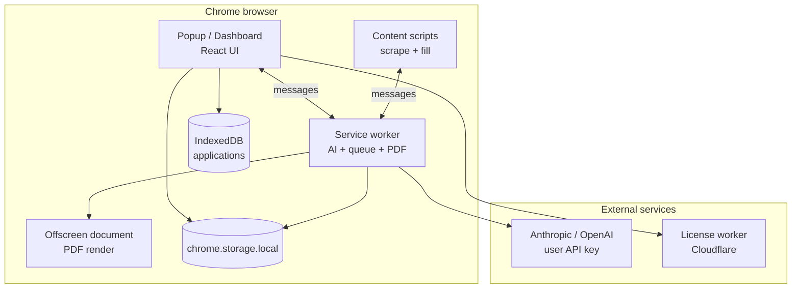

# Architecture

High-level design of the Blitz Chrome extension and related services.

## Overview

## Message flow (application generation)

1. Content script detects job page and scrapes job + form metadata.
2. Popup shows review / generate UI; user triggers generation.
3. Popup sends `GENERATE_APPLICATION` (or queue equivalent) to **background**.
4. Background loads CV/profile from storage, calls **AI** with prompts from `popup/src/lib/prompts.js`.
5. Response parsed in `popup/src/lib/ai.js`; results stored for review.
6. User approves → popup sends `FILL_FORM` → content script fills fields with human-like delays.

## Module boundaries

| Layer | May do | Must not do |
|-------|--------|-------------|
| `popup/` | UI, storage reads/writes via lib, sendMessage | Direct AI fetch |
| `background/` | AI, license checks, queue, offscreen PDF | DOM access on job pages |
| `content/` | DOM scrape/fill on job origins | AI calls, storage of secrets |
| `offscreen/` | Canvas/PDF only | User-facing UI |

Shared logic lives in `popup/src/lib/` and is imported by background via relative paths (`storage.js`, `ai.js`, `license.js`, etc.).

## Storage model

| Data | Location |
|------|----------|
| CV text, profile, API key, settings, queue | `chrome.storage.local` via `storage.js` |
| Application history snapshots | IndexedDB `blitz_db` via `db.js` |

## PDF pipeline

1. Popup requests PDF via background message.
2. Background opens offscreen document.
3. `offscreen/pdf-generator.js` uses vendored **html2canvas** + **jsPDF** (no CDN — MV3 CSP).

See [CV_HTML_PDF.md](CV_HTML_PDF.md) for template/HTML details.

## Full workspace (dashboard + local web)

- **Extension dashboard**: `popup/dist/dashboard.html` — same React app as popup with `fullPage` and `SiteShell` sidebar.
- **Local web**: `npm run web:dev` serves `web/`; talks to the extension via `externally_connectable` + extension ID (`popup/src/lib/extension-env.js`).
- Storage (`chrome.storage.local`) is shared; **IndexedDB application history** is per-origin (extension dashboard yes, localhost web no).

See [DASHBOARD.md](../DASHBOARD.md).

## On-page widget & page context

- `content/page-context.js` classifies the page (`single_job`, `job_list`, `search`, …) and exposes `canCapture`.
- `content/job-widget.js` shows a floating UI on supported job origins; `WIDGET_GENERATE` runs generation via the service worker.
- `content/detector.js` handles `GET_TAB_JOB_INFO` for the workspace tab list.

## Open job tabs → bulk queue

1. Workspace UI (`WorkspaceTabJobs.jsx`) sends `LIST_JOB_TABS`.
2. `background/tab-jobs.js` queries browser tabs, messages each for context + scrape.
3. User selects **Ready** tabs → `ADD_TABS_TO_QUEUE` (stores `jobData`, `sourceTabId` when available).
4. `queue-processor.js` reuses the user’s tab when still open; otherwise opens a background tab.

## License / Pro tier

- Free tier: 15 applications (`popup/src/lib/license.js`).
- Pro: key validated against Cloudflare Worker (`license-worker/`).
- Endpoint configured in `popup/src/lib/config.js` (`LICENSE_ENDPOINT`).

## Build output

Vite builds React entry points to `popup/dist/`. The unpacked extension root is the repo root; `manifest.json` references `popup/dist/index.html` and `popup/dist/dashboard.html`.

## Adding a job board

1. Add content script in `manifest.json` matches.
2. Implement detector/scraper in `content/`.
3. Register platform in `content/detector.js`.
4. Add fill logic; gate behind user-approved `FILL_FORM`.
5. Document platform in README supported table.

## Security notes

- BYOK: API keys never leave the user's machine except to the chosen AI provider.
- Do not log keys, CV text, or PII.
- No remote scripts in extension pages.
